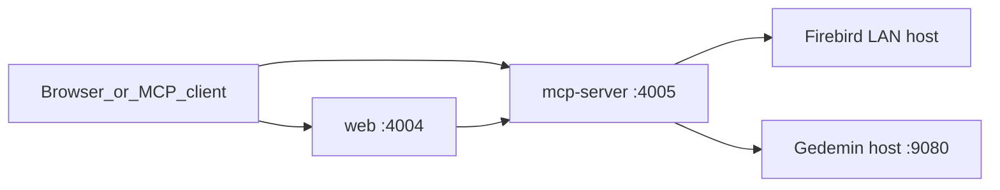

# Развёртывание MCP Nexus v2 на удалённом Windows-сервере (Docker)

Пошаговая инструкция для рабочей схемы:

| Компонент | Где работает |
|-----------|-------------|
| **mcp-server** (HTTP MCP `:4005`) | Docker-контейнер на Windows-хосте |
| **web** (чат UI `:4004`) | Отдельный Docker-контейнер на том же хосте |
| **Firebird 5** (база) | Другой компьютер в LAN |
| **Gedemin** (воркер отчётов `:9080`) | Windows на том же хосте, что и контейнеры (не в Docker) |



Репозиторий: ветка `feature/mcp-v2` (или актуальный релиз с `docker-compose.stack.yaml`).  
Целевой каталог на сервере (пример): `C:\Git\MCP-Nexus-v2`.

### Быстрый путь (один скрипт)

Если репозиторий уже есть на машине (или можно клонировать с GitHub), на Windows-хосте:

```powershell
# Один раз скопируйте scripts\bootstrap-remote-stack.ps1 на сервер
# либо сразу работайте из клонированного репо:
cd C:\Git\MCP-Nexus-v2
powershell -ExecutionPolicy Bypass -File .\scripts\bootstrap-remote-stack.ps1
```

Скрипт сам проверит Git / Node / **Docker Desktop** (если нет — поставит через winget, запустит, дождётся engine, проверит Linux containers / WSL), подтянет ветку (если это git-клон), подготовит `.env`, по возможности создаст `STARTUSER`/`mcp_worker`, поднимет Gedemin `:9080` и Docker-стек, затем проверит `/ready`.

Если репозиторий уже скачан и pull не нужен:

```powershell
powershell -ExecutionPolicy Bypass -File .\scripts\bootstrap-remote-stack.ps1 -SkipGitPull
```

Параметры: `-NonInteractive`, `-SkipWingetInstall`, `-SkipWorker`, `-OpenFirewall`, `-SkipGitPull` и др. — см. [scripts/bootstrap-remote-stack.ps1](../scripts/bootstrap-remote-stack.ps1).

После первой установки Docker Desktop иногда нужен **перезаход в Windows** (PATH) или reboot для WSL2 — скрипт напишет об этом явно.

Ниже — ручные шаги, если скрипт нельзя использовать.

---

## 0. Требования на Windows-хосте (где Docker + Gedemin)

1. Windows Server / Windows 10+ с доступом в LAN к серверу Firebird.
2. **Docker Desktop** (или Docker Engine + Compose v2) с поддержкой Linux-контейнеров.
3. Установленный **Gedemin** (exe воркера), который умеет веб на `:9080`.
4. **Клиент Firebird 5** на хосте (для самого Gedemin `/Q`, не для контейнера mcp-server — в образе уже есть `libfbclient`).
5. Git (чтобы клонировать/обновить репозиторий).
6. Открытые порты на хосте (локально и при необходимости в LAN/firewall):
   - `4004` — UI  
   - `4005` — MCP HTTP  
   - `9080` — только localhost (воркер Гедымина; снаружи не открывать)

На машине с базой Firebird должен слушаться нужный порт (пример: `3056`), путь к `.FDB` — тот, что укажете в `.env`.

---

## 1. Получить код

```powershell
cd C:\Git
git clone https://github.com/hirurg-lybitel/MCP-Nexus.git MCP-Nexus-v2
cd MCP-Nexus-v2
git checkout feature/mcp-v2
git pull
```

Если репозиторий уже есть:

```powershell
cd C:\Git\MCP-Nexus-v2
git fetch origin
git checkout feature/mcp-v2
git pull
```

---

## 2. Подготовить `.env`

```powershell
cd C:\Git\MCP-Nexus-v2
Copy-Item .env.stack.example .env
notepad .env
```

Обязательно заполнить (пример для Broiler / LAN FB):

```env
NODE_ENV=production
PORT=4004
MCP_PORT=4005
NEXT_PUBLIC_MCP_PORT=4005
MCP_HOST=0.0.0.0
MCP_API_KEY=<длинный_секрет>

# Firebird на ДРУГОМ компьютере в LAN — IP хоста БД, не localhost
NODE_FB_HOST=192.168.0.62
NODE_FB_PORT=3056
NODE_FB_DB=k:/Bases/Broiler/GDBASE_2026_02_05.FDB
ISC_USER=SYSDBA
ISC_PASSWORD=<пароль>
FIREBIRD_SQL_DIALECT=3
FIREBIRD_MIN_ENGINE_MAJOR=5

# Gedemin на ЭТОМ Windows-хосте; из контейнера — host.docker.internal
GEDEMIN_WORKER_URL=http://host.docker.internal:9080
GEDEMIN_WORKER_USER=mcp_worker
GEDEMIN_WORKER_PASSWORD=<пароль_mcp_worker>
GEDEMIN_WORKER_TOKEN=<токен_воркера>
GEDEMIN_WORKER_EXE=C:\WebServer\gedemin.exe
GEDEMIN_WORKER_SN=192.168.0.62/3056:k:/Bases/Broiler/GDBASE_2026_02_05.FDB

# Web → MCP внутри docker-сети (compose тоже переопределяет)
MCP_UPSTREAM_URL=http://mcp-server:4005/mcp
WEB_EMBEDDED_MCP=0

# Для чата UI (прокси OpenAI на стороне web)
OPENAI_API_KEY=sk-...
NEXT_PUBLIC_OPENAI_SECURITY_KEY=<ключ_прокси_если_нужен>
```

Важно:

- **`NODE_FB_HOST`** = IP/имя машины с Firebird в LAN. Не ставьте `localhost` / `127.0.0.1` — из контейнера это не хост Docker и не сервер БД.
- **`GEDEMIN_WORKER_URL`** всегда `http://host.docker.internal:9080` для доступа из контейнера к Gedemin на Windows-хосте.
- Пустой пароль и пользователь `Administrator` для `/Q` часто показывают UI логина — используйте **`mcp_worker`**.

---

## 3. Пользователь Firebird / STARTUSER и mcp_worker

На хосте с доступом к базе (через клиент FB) один раз:

```powershell
cd C:\Git\MCP-Nexus-v2
# при необходимости: PATH к клиенту FB5
$env:PATH = "C:\FB5;$env:PATH"

powershell -ExecutionPolicy Bypass -File .\scripts\deploy-working.ps1 -Action create-startuser
powershell -ExecutionPolicy Bypass -File .\scripts\deploy-working.ps1 -Action create-user
```

Проверка ключей `.env`:

```powershell
powershell -ExecutionPolicy Bypass -File .\scripts\deploy-working.ps1 -Action check
```

При необходимости установите namespace-обработчики воркера:

```powershell
powershell -ExecutionPolicy Bypass -File .\scripts\deploy-working.ps1 -Action install-namespace
```

(После install перезапустите Gedemin-воркер.)

---

## 4. Запустить Gedemin на хосте (:9080)

Gedemin должен работать **на Windows рядом с Docker**, слушать `127.0.0.1:9080`, вход без интерактивного диалога:

```powershell
cd C:\Git\MCP-Nexus-v2
$env:PATH = "C:\FB5;$env:PATH"
powershell -ExecutionPolicy Bypass -File .\scripts\deploy-working.ps1 -Action worker
```

Либо напрямую:

```powershell
node packages\report-worker\scripts\start-worker.mjs
```

Проверка с хоста:

```powershell
Invoke-RestMethod http://127.0.0.1:9080/test
```

Если появляется окно «Вход в систему» с пустым Admin — тихий `/Q` не сработал; исправьте `GEDEMIN_WORKER_USER` / пароль / `STARTUSER`, не кликайте Войти как постоянное решение.

---

## 5. Собрать и поднять контейнеры

Из корня репозитория:

```powershell
cd C:\Git\MCP-Nexus-v2
powershell -ExecutionPolicy Bypass -File .\scripts\working-stack-up.ps1
```

Эквивалент вручную:

```powershell
$env:GEDEMIN_WORKER_URL = 'http://host.docker.internal:9080'
docker compose -f docker-compose.stack.yaml --env-file .env up -d --build
```

Скрипт `working-stack-up.ps1`:

- поднимает **mcp-server** и **web**;
- проверяет `GET http://127.0.0.1:4005/ready`;
- для LAN-IP Firebird оставляет `NODE_FB_HOST` как в `.env`;
- если в `.env` случайно `localhost`, временно подменяет на `host.docker.internal` (только для локальных стендов).

Остановка:

```powershell
docker compose -f docker-compose.stack.yaml down
# или: pnpm docker:stack:down
```

---

## 6. Проверка

### MCP

```powershell
Invoke-RestMethod http://127.0.0.1:4005/health
Invoke-RestMethod http://127.0.0.1:4005/ready
```

Ожидаемо в `/ready`:

- `ok: true`
- `firebird: true`
- `mcpApiKey: true`
- `worker.reachable: true`
- `worker.loginOk: true`

MCP endpoint: `http://127.0.0.1:4005/mcp`  
Заголовок: `Authorization: Bearer <MCP_API_KEY>`.

### UI

Откройте `http://127.0.0.1:4004` (или `http://<IP-хоста>:4004` из LAN).

В Settings:

1. OpenAI token (как требует UI / прокси).
2. MCP access key = значение `MCP_API_KEY` из `.env` → **Verify and save**.

---

## 7. Типичные проблемы

| Симптом | Что проверить |
|---------|----------------|
| `firebird: false` / connection to host failed | `NODE_FB_HOST` = LAN IP сервера БД; порт открыт с Windows-хоста Docker; путь `NODE_FB_DB` верный для FB-сервера |
| `worker unreachable` / timeout | Gedemin запущен на хосте; `http://127.0.0.1:9080/test` отвечает; в compose есть `extra_hosts: host.docker.internal:host-gateway` |
| `loginOk: false` | пользователь `mcp_worker`, не пустой Admin; STARTUSER / create-user |
| UI: `OpenAI is not configured on the server` | в `.env` задан `OPENAI_API_KEY`, контейнер web пересоздан: `docker compose ... up -d --force-recreate web` |
| UI: MCP key required | в Settings введён тот же `MCP_API_KEY`, что в `.env` |
| Долгая первая сборка | нормально: build образов `mcp-server` и `web` с native FB-клиентом |

---

## 8. Обновление версии

```powershell
cd C:\Git\MCP-Nexus-v2
git pull
docker compose -f docker-compose.stack.yaml --env-file .env up -d --build
Invoke-RestMethod http://127.0.0.1:4005/ready
```

---

## Ссылки на файлы в репозитории

| Файл | Назначение |
|------|------------|
| [docker-compose.stack.yaml](../docker-compose.stack.yaml) | Два сервиса: mcp-server + web |
| [.env.stack.example](../.env.stack.example) | Шаблон env для LAN FB + host Gedemin |
| [scripts/working-stack-up.ps1](../scripts/working-stack-up.ps1) | Сборка, up, проверка `/ready` |
| [scripts/deploy-working.ps1](../scripts/deploy-working.ps1) | check / STARTUSER / mcp_worker / worker |
| [apps/mcp-server/Dockerfile](../apps/mcp-server/Dockerfile) | Образ MCP |
| [apps/web/Dockerfile](../apps/web/Dockerfile) | Образ UI |

Локальная проверка эталонов (опционально, на стенде с BG):  
`node apps/mcp-server/scripts/run-pilot-answers.mjs`,  
`npx tsx apps/web/scripts/run-pilot-eval.ts`.
