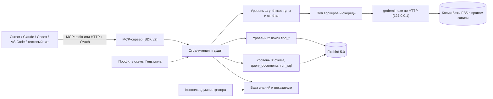

# MCP-сервер для учётной системы Гедымин — версия 2

**Статус:** этап 2 — MVP (в работе). 2.1–2.4 и 2.10 закрыты (2026-11-09/10).
**Обновлено:** 2026-11-04.

Исходная постановка — [tz-original.md](tz-original.md). Факты и исследования — [findings.md](findings.md). Открытые вопросы — [questions.md](questions.md).

## Цель

MCP-сервер только для чтения, через который пользователи учётной системы на платформе Гедымин работают с данными на естественном языке из любого MCP-клиента: Cursor, Claude Desktop, Codex, VS Code и других. Главный критерий качества из ТЗ: числа в ответе совпадают со штатным отчётом за те же параметры, а правдоподобный неверный ответ хуже отказа.

Отличие от текущей версии: сейчас агент сам ищет таблицы, пишет SQL и интерпретирует строки, поэтому результаты не воспроизводятся. В версии 2 учётную логику считает сервер (штатные отчёты через отчётный воркер), модель только выбирает инструмент, параметры и объясняет результат.

## Принятые решения

Дополняют или уточняют ТЗ. Новые решения добавляются в конец списка.

| № | Решение | Причина |
|---|---|---|
| D1 | Сервер работает с любым MCP-клиентом. Стандарты: MCP 2026-07-28 с совместимостью для клиентов 2025 года (TypeScript SDK v2), Agent Skills, `AGENTS.md`. Транспорты: stdio и Streamable HTTP. Результат тула не зависит от клиента (D19); ручная проверка — в Cursor, другие клиенты владельцу недоступны. Сначала всё проверяется локально (stdio и HTTP на `127.0.0.1`, bearer-токен или переменные окружения); OAuth 2.1 по спецификации MCP — при переносе в облако | В ТЗ указаны только Claude Desktop и Codex; решение владельца от 2026-11-02 о локальной проверке |
| D2 | Целевая (и единственная поддерживаемая) версия Firebird — **5.0**. MCP по умолчанию использует полный SQL FB5 (CTE, `WITH RECURSIVE`, оконные функции, `OFFSET/FETCH`). Клиенты на 2.5 **обновляют базу до 5**; режим `FIREBIRD_SQL_DIALECT=2.5` — только локальный/тестовый override, не продукт. Профиль схемы Гедымина (наличие объектов) остаётся отдельной осью | Решение владельца, 2026-11-05: не тянуть совместимость с 2.5 в продукт |
| D3 | Числа считает сервер; системный промпт и `domain context` веб-чата упраздняются. Знания отдаются по требованию через тулы, ресурсы и `instructions` | Воспроизводимость ответов |
| D4 | Развиваем текущий репозиторий. `packages/db-firebird` сохраняется как ядро уровня 3; MCP-слой переписывается на SDK v2 в отдельном приложении без Next.js | Слой Firebird написан чисто и покрыт тестами; MCP-слой маленький и устарел по спецификации |
| D5 | Веб-чат остаётся тестовым стендом и становится обычным MCP-клиентом (берёт `instructions`, prompts, skills с сервера). Рядом — консоль администратора (карточки, показатели, аудит, тесты) | Решение владельца, 2026-11-02 |
| D6 | Один экземпляр сервера на клиента (одну базу) | Решение владельца, 2026-11-02 |
| D7 | Отчётный воркер `gedemin.exe` есть у всех клиентов, уровень 1 считается через воркер. Штатные процедуры БД (`AC_CIRCULATIONLIST_BAL` и др.) используются для сверки в тестах | Решение владельца, 2026-11-02 |
| D8 | Исходники используемой сборки — `D:\Git\gedemin-private`, ветка `delphi7` (2.9.7.13137, установленный exe — 2.9.7.13136) — используются только для чтения: понять поведение платформы и сослаться на место в коде (D18). Публичный репозиторий отстаёт на несколько лет (findings §4) | Решение владельца от 2026-11-02 |
| D9 | Внутренние проводки определяются как в `AC_CIRCULATIONLIST_BAL` (`DONTINMOVE`): пары с равными суммами на одном счёте внутри записи **и** все проводки операций с `ISINTERNAL = 1` | ТЗ описывает только первый случай; иначе обороты разойдутся со штатными отчётами |
| D10 | Ядро-представления `v_*` реализуются как CTE-шаблоны, которые сервер подставляет в запрос; DDL в базе клиента не нужен. При разрешённом DDL их можно материализовать | CTE работают начиная с Firebird 2.1, базы клиентов могут быть недоступны для изменений |
| D11 | Тестовые стенды: Firebird 2.5.9 (порт 3052, `CRM.FDB`) и Firebird 5.0.4 (порт 3055, копия `CRM_FB5.FDB`) на одних и тех же данных. Оригинальная база не обновляется | Расхождение цифр между версиями сразу указывает на проблему совместимости |
| D12 | Учётный тул обязан распознавать подмену пустым отчётом (`EgsLargeSQLStatement`) и возвращать ошибку, а не нули | «Неверный ответ хуже отказа» |
| D13 | Денежные суммы и количества передаются модели десятичными строками с валютой или единицей измерения, без преобразования в число с плавающей точкой. На Firebird 4+ сервер сам переводит `INT128`/`DECFLOAT` в устаревшие типы для своего соединения (`SET BIND … TO LEGACY`) и не полагается на `DataTypeCompatibility = 2.5` в `firebird.conf` клиента | Без этой настройки на FB5 `SUM()` по `NUMERIC(15,4)` возвращает `INT128`, драйвер отвечает «Data type unknown». Инструкция платформы её требует, но у клиента её может не оказаться (findings §3а, §3б) |
| D14 | Профиль совместимости проверяет не только версию и объекты, но и работоспособность UDF: таблицы с вычисляемыми полями на недоступных UDF помечаются как недоступные, тул объясняет причину | На FB5 без 64-битной `gudf` и `UdfAccess = Restrict UDF` не читается даже `GD_DOCUMENT` (findings §3а) |
| D15 | Генерация карточек базы знаний: провайдер модели подключаемый (OpenAI-совместимый API, ключ OpenAI в проекте уже есть). Модель выбирается пилотом на 10 самых частых операциях: карточки генерируются моделью среднего и флагманского уровня, затем дешёвая модель по карточке предсказывает проводки реальных документов. Берётся самая дешёвая модель генерации, которая проходит порог совпадения; для массового прогона — пакетный режим API. Карточки, ручные правки и хеши входа хранятся в этом репозитории (`knowledge/`) | Решение поручено разработке (Q9, Q10). Пилот дешевле, чем гадать: ошибка в выборе модели проявляется как неверные карточки на 290 операциях |
| D16 | Тестовый набор собирается разработкой по данным `CRM.FDB` и общедоступным источникам (типовые вопросы бухгалтеров, типовой план счетов РБ). Эталон для чисел — штатный отчёт Гедымина через воркер; вопросы, где нужна оценка бухгалтера, помечаются и ждут проверки | Бухгалтеров для разметки пока нет (Q7) |
| D18 | Изменения в платформу Гедымин (исходники, сборка `gedemin.exe`) не вносятся. Всё решается на стороне MCP-сервера и штатными средствами платформы: обработчики воркера — скрипт-функции в отдельном пространстве имён (YAML, устанавливается и удаляется штатно), настройки — `gedemin.ini` и `firebird.conf`. Неизбежные изменения записываются инструкцией в [platform-changes.md](platform-changes.md): что, где и зачем менять; вносит их автор платформы | Решение владельца от 2026-11-02 |
| D19 | Одинаковые результаты в любом клиенте обеспечивает сервер: ответ тула при одинаковых параметрах и данных одинаков побайтно независимо от клиента, транспорта (stdio или HTTP) и версии протокола (2025 или 2026). Это проверяют автотесты протокола независимым клиентом (MCP SDK) и MCP Inspector. Ручная проверка с моделью — Cursor и тестовый чат проекта. Различаться между клиентами может только то, как модель пересказывает ответ | Владельцу доступен только Cursor; требование одинаковых результатов по стандартному протоколу |
| D20 | Runtime SQL и инструкции модели ориентированы на Firebird 5; стенд 2.5 (`3052`) сохраняется для сверки цифр и воркера, но не как целевой диалект продукта | Уточнение D2, 2026-11-05 |
| D21 | База знаний модуля — ответы опросника 2026-11-05, не коды одной базы. Счета 60/62/76 и стандартный первый уровень 90 задают смысл; субсчета клиента не переносятся. Внутренняя проводка — необязательный фильтр только оборота в ОСВ, журнале-ордере и карте счёта (один счёт и те же аналитики отчёта по дебету и кредиту, операция помечена внутренней). Развёрнутое сальдо — `AC_ACCANALYTICSEXT`, не `ANALYTICALFIELD`. Открыт вопрос Б7: как именно колонка `USR$` становится аналитикой счёта | Ответы бухгалтера и автора платформы в [knowledge-questionnaire.md](knowledge-questionnaire.md) |
| D17 | Разработка v2 ведётся в отдельном worktree `D:\Git\MCP-Nexus-v2`, ветка `feature/mcp-v2` от `main`. Текущее развёртывание (onrender.com, образ в GHCR) не трогается до выхода v2 | Решение владельца, 2026-11-02 (Q12) |

## Целевая архитектура

### Предварительная структура репозитория

| Путь | Назначение |
|---|---|
| `apps/mcp-server` | MCP-сервер: регистрация тулов, ресурсов, промптов, транспорты, авторизация, аудит |
| `apps/web` | Тестовый чат (MCP-клиент) и консоль администратора |
| `packages/db-firebird` | Подключение, пул, исполнитель запросов только на чтение, профиль совместимости, метаданные `AT_*` |
| `packages/gedemin-domain` | Учётная семантика: счета, аналитики, корреспонденция, CTE-шаблоны `v_*`, параметры отчётов |
| `packages/report-worker` | Клиент отчётного воркера, пул, очередь, перезапуск; VBScript-обработчики и шаблоны `gedemin.ini` |
| `packages/knowledge-base` | Сборщик входа, генерация и проверка карточек, каталог отчётов, импорт вики |
| `packages/evals` | Тестовый набор вопросов, прогон, метрики |
| `docs/specs` | Постановки и планы (этот файл) |

## Этапы и задачи

Обозначения: `[x]` — сделано и проверено, `[ ]` — не начато, `[~]` — в работе. «Блокирует» — задача, без которой нельзя начать указанную.

### Этап 0. Технический прототип

Цель — снять технические риски до основной разработки.

- [x] 0.1 Изучить текущую реализацию, ТЗ, окружение, базу, исходники платформы и прикладных решений, вики → [findings.md](findings.md)
- [x] 0.2 Стенд Firebird 5.0.4: служба `Firebird_5_0`, порт 3055, копия базы `D:\Soft\gedemin\Databases\CRM_FB5.FDB` из бэкапа `CRM_20261102_fb25.fbk` (бэкап снят сервером 2.5 без сборки мусора, оригинал не изменялся). Восстановление без ошибок, 17 предупреждений о функциях `gudf`
- [x] 0.2а Стенд FB5 приведён к инструкции платформы по миграции (findings §3б): `UdfAccess = Restrict UDF`, `DataTypeCompatibility = 2.5`, `ServerMode = Classic`, `OuterJoinConversion = false`, параллельные потоки; 64-битная `gudf.dll` в `D:\Soft\Firebird\Firebird_5_0\UDF`
- [~] 0.3 Сверить стенды 2.5 и 5.0. Сделано: объёмы `AC_ENTRY`/`AC_RECORD`, суммы проводок и ОСВ одной компании через `AC_CIRCULATIONLIST_BAL` совпадают; после 0.2а читаются `GD_DOCUMENT` (344 205 записей) и все вычисляемые поля на UDF, `SUM()` работает без приведения типов. Осталось: сверка на 5–10 компаниях и периодах, включая полный 2022 год «Амперсант ООО»; случай с внутренними проводками (блокирует 0.10)
- [x] 0.4 Выделить MCP-сервер в `apps/mcp-server` на SDK v2 (`@modelcontextprotocol/server` 2.4): stdio и stateless HTTP (`createMcpHandler` + `legacy: 'stateless'`), `instructions`, без демо-тулов; bearer `MCP_API_KEY`; smoke-тест протокола. Проверено: `tools/list` и `run_sql` → `COUNT(*) FROM AC_ENTRY` = 336304
- [~] 0.5 Профиль в `db-firebird`. Сделано: диалект `3` по умолчанию; gate ENGINE_VERSION ≥ 5; `SET BIND INT128/DECFLOAT TO LEGACY` + нормализация сумм/BLOB (D13); `getCompatibilityProfile` — UDF-пробы и `unavailableTables` (D14). Осталось: каталог возможностей схемы для guard; отменяемый таймаут; пул
- ~~0.6 Отдельный пользователь Firebird только на чтение~~ — отменено, владелец оставляет `SYSDBA` (Q3). Только чтение обеспечивают транзакции `READ ONLY` и проверка SQL; в `.env` и логах пароль не выводится
- [x] 0.7 Конфигурация воркера. Запуск: `start-worker.mjs` с `/SN localhost/3052:…CRM_WORKER.FDB` (алиас `/SN CRM_WORKER` ломает `ReadFromCmdLine`), веб `127.0.0.1:9080` OK; права Users на «Амперсант» в `GD_OURCOMPANY.AFULL`
- [x] 0.8 VBScript-обработчик ОСВ на `TgdvAcctCirculationList` (ASCII-JSON + секрет), YAML в `packages/report-worker/namespace`, по образцу Naytron API. Эталон Амперсант 01.01–31.10.2023: 41 счёт, Дт 515139.5 / Кт 168102.5
- [x] 0.9 Тулы `get_trial_balance` и `run_sql`. ОСВ предпочитает воркер (`source: tgdv_acct_circulation_list`), fallback на `AC_CIRCULATIONLIST_BAL`. D19: `protocol.test.ts` — tools/list одинаков для `2024-11-05` / `2025-03-26` / `2025-11-25`; `tools/call get_trial_balance` эталон 41 / 515139.5 / 168102.5
- [x] 0.10 Эталонная сверка ОСВ: воркер = `AC_CIRCULATIONLIST_BAL` на FB2.5 (`CRM_WORKER`) и FB5 (`CRM_FB5`) для 01.01–31.10.2023 и полного 2022; скрипт `packages/report-worker/scripts/reconcile-osb.mjs`. Экран = процедура — 0.3
- [x] 0.11 Обходные пути [platform-changes.md](platform-changes.md): ASCII-JSON и `token` проверены на живом воркере; `supervisor.ts` — детект/dismiss модалок, `start-worker.mjs` не стартует второй процесс если порт уже отвечает. Полный супервизор (цикл + ошибка вместо пустого отчёта, пул) — этап 2.3–2.4. Непреодолимых блокеров нет (D18). Оценка: этап 1 ≈ 1–1.5 нед., этап 2 ≈ 2–3 нед., этапы 3–4 ≈ по 1.5–2 нед., 5–6 ≈ по 1 нед. (при стабильном воркере)

**Критерий перехода:** ОСВ, запрошенная из Cursor, совпадает со штатной ОСВ за тот же период на обоих стендах; автотест протокола подтверждает одинаковый ответ на всех транспортах; обходные пути проверены, обязательных изменений платформы нет или они описаны; сроки оценены.

### Этап 1. Подготовка данных (параллельно с этапами 0–2)

- [x] 1.1 Каталог [control-questions.md](control-questions.md): 80 вопросов (≈70 auto / ≈10 needs-accountant), эталоны Амперсант 2022/2023
- [x] 1.2 CTE в `@mcp-nexus/accounting-sql` + smoke `pnpm smoke:cte` (CTE turnover = процедура за 2023 и 2022 с/без DONTINMOVE)
- [x] 1.3 D9: фикстура Ampersant 2022 (`debit_ex=9722349.77`, `debit_in=10034410.48`); воркер `includeInternal` совпадает; CTE совпадает с процедурой
- [~] 1.4 Каталог схемы `schema-catalog.json`: 976 таблиц, 100 типов документов, 24 USR$ на AC_ENTRY. Осталось: заполненность и шаблоны SELECT на тип
- [~] 1.5 `inventory-snapshot.json`: counts + топ операций Амперсант 2022. Осталось: RP_* статистика запуска
- [x] 1.6 Примеры SQL в `@mcp-nexus/accounting-sql` (`sqlExamples`): оборот, issimple-корреспонденция, процедура ОСВ, документы, ISINTERNAL (FB 2.5+)
- [ ] 1.7 Разобраться на данных с операцией «Проводки за прошлые года» и закрытием периода

**Критерий перехода:** ядро даёт те же обороты и сальдо, что штатная ОСВ, на 5–10 контрольных счетах; описание схемы покрывает все типы документов.

### Этап 2. MVP

- [x] 2.1 Авторизация для локальной работы: bearer-токен для HTTP (`MCP_API_KEY` обязателен), проверка env при старте stdio/HTTP, probe логина воркера через `/test` (без пароля в логах), rate limit 401→429; `/ready`. OAuth 2.1 — при переносе в облако (D1)
- [x] 2.2 Аудит всех вызовов: JSONL (`MCP_AUDIT_LOG`, по умолчанию `logs/mcp-audit.jsonl`); поля user/tool/args/sql/durationMs/rowCount/ok; redaction секретов; обёртка всех `registerTool`; отключение `MCP_AUDIT=0`
- [x] 2.3 Надёжность воркера без изменения платформы (D18): `WorkerSupervisor` (модалки → dismiss/рестарт, порт → рестарт), `WORKER_BLOCKED_EMPTY` вместо тихих нулей, token bake при install (`{{MCP_WORKER_TOKEN}}`), loopback-only host, `uninstall-namespace.mjs`, `supervise-worker.mjs`
- [x] 2.4 Пул из 2–4 воркеров: `WorkerPool` (FIFO + `WORKER_QUEUE_TIMEOUT` / `WORKER_TIMEOUT`), `GEDEMIN_WORKER_URLS` / `POOL_SIZE`, hung → restart слота, `supervise-pool.mjs`; size=1 совместим с 2.3
- [x] 2.5 Тулы поиска: `find_account`, `find_counterparty`, `find_document_type`, `find_item`, `find_analytics_value`
- [x] 2.6 Учётные тулы: `get_trial_balance`, `get_journal_order` (SQL CTE issimple-пары → pivot; нативный `TgdvAcctLedger` ломается пустым HAVING при `UseEntryBalance`), `get_account_card`, `get_account_analysis`, `get_account_saldo`; D12 — отказ при подмене пустым SQL (`RDB$CHARACTER_SET_NAME = '_'`)
- [x] 2.7 Сохранённые конфигурации: `list_report_configs`, `run_report_config` (воркер `LoadConfig`+`BuildReport`; классы Card/Ledger/CirculationList/Review)
- [x] 2.8 Документы: `get_documents`, `get_document` (список за период + стороны проводок)
- [x] 2.9 Инструкции сервера; `dataCutoff` (MAX AC_ENTRY.ENTRYDATE) в успешных ответах тулов
- [x] 2.10 Тестовый чат переведён на чистый MCP-клиент (D5): BFF → `MCP_UPSTREAM_URL` (v2); embedded MCP off by default; system prompt из `initialize.instructions` + web host tools; `run_sql` UI alias

**Критерий перехода:** учётные вопросы тестового набора проходят во всех целевых клиентах; 2–3 бухгалтера работают в пилоте.

### Пилот: точность ответов (высокий ROI) — в работе

Постановка: [roi-accuracy-fix.md](roi-accuracy-fix.md). Scope: только ясные исправления, без костылей (решение 2026-11-11).

- [x] R1, R3–R4 + частичный R2: инструкции / describe (ЖО MONTH, ДЗ/КЗ стороны, siblings, 90≠выручка по имени)
- [x] R5: `get_analytics_balance` по алгоритму `AC_ACCOUNTEXSALDO_BAL`; `fieldName` из `AC_ACCANALYTICSEXT` (без default `USR$GS_CUSTOMER`)
- [ ] Вне scope: R6 контекст даты; `periodTotals`; `list_metrics` (этап 5)
- [ ] Регрессия A4, B1, A2, C2 после деплоя MCP

### Этап 3. Документы, SQL и пользовательские отчёты

- [ ] 3.1 `search_schema`, `get_document_type_schema`, `query_documents` с признаком наличия проводок
- [ ] 3.2 `run_sql` с ограничениями по профилю совместимости, `describe_views`, `get_sql_examples`
- [ ] 3.3 Парсер `gd_function.enteredparams` (`SLPR`/`FLPR`), тулы `list_reports`, `run_report`
- [ ] 3.4 Невизуальный запуск пользовательского отчёта в воркере с возвратом `IgsQueryList`
- [ ] 3.5 Пробный запуск всех отчётов и отбор пригодных для каталога

### Этап 4. База знаний (параллельно с этапами 2–3)

- [ ] 4.1 Сборщик входа для саммаризации: код из `gd_function` с зависимостями, метаданные, статистика, примеры документов; связь с YAML `gedemin-apps` по RUID
- [ ] 4.2а Пилот выбора модели на 10 самых частых операциях (D15)
- [ ] 4.2 Карточки типовых операций (около 290), начиная с самых частых; сверка со статистикой и проверка предсказанием
- [ ] 4.3 Проверка проблемных карточек (заказчик)
- [ ] 4.4 Каталог отчётов с описаниями
- [ ] 4.5 Тулы `get_document_type_info`, `get_posting_stats`, `get_report_info`; перегенерация устаревших карточек по хешу
- [ ] 4.6 Импорт вики платформы (`action=raw`) и тул `search_platform_docs`

### Этап 5. Аналитика

- [~] 5.1 Привязка счетов к показателям. Сделано: предложения по типовому плану счетов РБ в [account-metrics.md](account-metrics.md) (описания счетов в `CRM.FDB` пустые). Осталось: проверка ответственным (Q13), запись подтверждённых привязок в описания счетов или в файл конфигурации, проверка полноты
- [ ] 5.2 `list_metrics`, `get_metric_definition` и аналитические тулы из ТЗ
- [ ] 5.3 Методики анализа из одного источника: MCP prompts, Agent Skills, `AGENTS.md`
- [ ] 5.4 Рубрика экспертной оценки и аналитические сценарии в тестовом наборе (заказчик)

### Этап 6. Развитие

- [ ] 6.1 Консоль администратора: проверка карточек, полнота показателей, аудит, история прогонов тестов
- [ ] 6.2 MCP Apps для таблиц и графиков (с текстовым ответом для клиентов без поддержки)
- [ ] 6.3 Режим разработчика: `get_posting_script`, `get_report_source`
- [ ] 6.4 Вынос частых SQL-шаблонов из аудита в тулы
- [ ] 6.5 Разграничение прав — по итогам пилота

### Сквозные задачи

- [ ] X.1 Матрица тестов на Firebird 5.0; сверка цифр со стендом 2.5 — только для миграции/регрессии, не как целевой runtime
- [ ] X.2 На каждом этапе: автотесты протокола (одинаковые ответы на всех транспортах и версиях протокола, D19) и прогон тестового набора в Cursor и тестовом чате
- [ ] X.3 Скиллы проекта: `firebird-compat` (правила SQL по версиям), `gedemin-accounting` (`issimple`, `lb/rb`, внутренние проводки, сальдо)
- [ ] X.4 `AGENTS.md` для репозитория

## Журнал

| Дата | Что изменилось |
|---|---|
| 2026-11-02 | Создан план. Сравнение текущей реализации с ТЗ, решения D1–D12. Исследованы окружение, база `CRM.FDB`, исходники `gedemin` и `gedemin-apps`, вики. Установлен Firebird 5.0.4 (порт 3055), снят бэкап `CRM.FDB`, восстановлена копия `CRM_FB5.FDB` |
| 2026-11-02 | Сверка стендов: ОСВ совпадает на 2.5 и 5.0. Найдены проблемы FB5: `INT128` в агрегатах и вычисляемые поля на UDF (`GD_DOCUMENT.USR$SORTNUMBER`). Добавлены решения D13, D14 |
| 2026-11-02 | Ответы владельца на Q1–Q12. Создан worktree `feature/mcp-v2`, документы перенесены туда. Стенд FB5 настроен по инструкции платформы, установлена 64-битная `gudf` — оба блокера FB5 сняты. Исходники сборки — `gedemin-private`, ветка `delphi7`. Решения D15–D17, задача 0.6 отменена, подготовлен черновик привязки счетов к показателям |
| 2026-11-02 | Изучены исходники `delphi7`: вход, пользователи, командная строка, веб-сервер, отчёты (findings §4). Создан пользователь воркера `mcp_worker` на обоих стендах. На FB5 исправлен порядок `UserManager` по инструкции, заведён `STARTUSER`. Найдена уязвимость платформы в `GD_P_SEC_LOGINUSER` (Q14) |
| 2026-11-02 | Q14 закрыт: владелец сообщил автору платформы. Q13 отложен владельцем. Добавлен Q15 — сборка доработок `gedemin.exe` (Delphi 7 на машине нет) |
| 2026-11-02 | Решения владельца: изменения в платформу не вносятся (D18), Delphi-доработки заменены обходными путями, неизбежные изменения — в [platform-changes.md](platform-changes.md); Q15 снят. Клиент для ручной проверки — только Cursor, одинаковость результатов подтверждают автотесты протокола (D19). Обновлены задачи 0.9, 0.11, 2.3, X.2 |
| 2026-11-02 | Начата разработка в worktree: `apps/mcp-server` на SDK v2 (0.4), `run_sql` работает, CTE разрешены на диалекте 2.5 (часть 0.5) |
| 2026-11-02 | `get_trial_balance` через `AC_CIRCULATIONLIST_BAL` (числа эталона совпали). Папка воркера `D:\Soft\gedemin-worker`, копия БД `CRM_WORKER.FDB`, каркас `packages/report-worker` |
| 2026-11-04 | Этап 0 закрыт по критерию перехода (ОСВ воркер=процедура FB2.5/FB5, D19). MVP: `get_account_card`, `get_account_analysis`, `get_account_saldo`, `find_item`, `find_analytics_value`, `dataCutoff` в ответах |
| 2026-11-04 | `get_journal_order` через pivot AccCard (Ledger: баг HAVING при UseEntryBalance); D12 — сентинел пустого SQL в обработчиках |
| 2026-11-05 | D2/D20: целевой runtime — только Firebird 5; диалект SQL по умолчанию `3` (окна, RECURSIVE, OFFSET/FETCH). Клиенты на 2.5 обновляют базу |
| 2026-11-05 | Gate при connect: `ENGINE_VERSION` major ≥ 5, иначе `FirebirdUnsupportedEngineError`; `.env` MCP → `localhost/3055` + `CRM_FB5.FDB` |
| 2026-11-05 | D13: `SET BIND … TO LEGACY` на соединении; `normalizeRowValues` — суммы строками, BLOB текстом; smoke `smoke-d13-normalize.mjs` |
| 2026-11-05 | D14: `CompatibilityProfileService` — пробы UDF из вычисляемых полей, список `unavailableTables`; smoke `smoke-d14-udf.mjs` на стенде с gudf |
| 2026-11-05 | В `instructions` добавлены знания бухгалтера: AC_RECORD/AC_ENTRY, NCU/CURR, денормализация, USR$/USR$GS_CUSTOMER, логика 62.00/62.07 |
| 2026-11-05 | D21: в инструкции перенесены ответы опросника. Смысл 60/62/76 и стандартного 90; аванс — сальдо, не отдельная ветка; внутренняя проводка только как фильтр оборота. Б7 без ответа |
| 2026-11-11 | Пилот чата: журнал багов [pilot-bugs.md](pilot-bugs.md). BUG-01…04 закрыты (prompts, companyKey, accountKey≠alias, decimal money + бел. руб.). BUG-05: `-32001` на годовой ОСВ для «выручка/прибыль» — timeout web 60 с vs worker 180 с + неверный выбор тула; фикс: `MCP_TOOL_CALL_TIMEOUT_MS=180000`, instructions/описание `get_trial_balance` (узкий путь 90/99). Слой `list_metrics`/`get_pnl` остаётся этапом 5 |
| 2026-11-11 | Полный прогон 19 контрольных вопросов директора и главбуха через стек чата (`BG_NEW_FB5`): матрица ответов, сверка с эталонами БД и 10 новых открытых дефектов **BUG-06…BUG-15** зафиксированы в [pilot-bugs.md](pilot-bugs.md) (без правок кода) |
| 2026-11-11 | Волна 1: закрыты **BUG-06** (`dataCutoff <= CURRENT_DATE` → `2026-10-31`), **BUG-09** (`withSubAccounts` default true + `summaryOnly`), **BUG-08** (Дт/Кт в `get_account_analysis` + правило «долги на дату → `get_balance`»). Контроль C2/A2/B1 — см. [pilot-bugs.md](pilot-bugs.md) |
| 2026-11-11 | Волна 1: закрыт **BUG-10** — `accountName`/`corrAccountName` в отчётах; `relatedSiblingAccounts` для коротких `51`/`62`/`90`; instructions про имена 90.* и группу денег `51*`/`52*` |
| 2026-11-11 | Волна 2: закрыт **BUG-12** — авто-таблица UI из учётных тулов (`parse-accounting-table`), `present_query_result.rows` снова first-class, system prompt требует totals в тексте |
| 2026-11-11 | Волна 2: закрыт **BUG-07** — тул `get_analytics_balance` (развёртка/топ по `USR$GS_CUSTOMER` → `GD_CONTACT`, `side`, `lastEntryDate`) |
| 2026-11-11 | Волна 3: закрыты **BUG-11** (ЖО SQL + Join AccCard), **BUG-14** (фильтр alias/offbalance в ОСВ), **BUG-13** (`reportKind` в list_report_configs), **BUG-15** (маскировка EXTRACT/TRIM/SUBSTRING + CTE в sql-table-names) |
| 2026-11-11 | Повторный прогон 19 вопросов: тулы без `isError`; качество ответов неравномерно. Постановка пакета высокого ROI: [roi-accuracy-fix.md](roi-accuracy-fix.md) (инструкции + analytics expanded; `list_metrics` — этап 5) |
| 2026-11-11 | ROI (узкий scope): инструкции R1/R3/R4 + 90≠выручка; `get_analytics_balance` = алгоритм `AC_ACCOUNTEXSALDO_BAL` (кэш + окно даты), `fieldName` из `AC_ACCANALYTICSEXT`; `GEN_ID(...,0)` разрешён в read-only SQL. Вне scope: R6, periodTotals, list_metrics |

