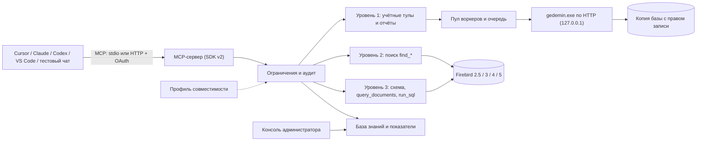

# MCP-сервер для учётной системы Гедымин — версия 2

**Статус:** этап 0 — технический прототип.
**Обновлено:** 2026-11-02.

Исходная постановка — [tz-original.md](tz-original.md). Факты и исследования — [findings.md](findings.md). Открытые вопросы — [questions.md](questions.md).

## Цель

MCP-сервер только для чтения, через который пользователи учётной системы на платформе Гедымин работают с данными на естественном языке из любого MCP-клиента: Cursor, Claude Desktop, Codex, VS Code и других. Главный критерий качества из ТЗ: числа в ответе совпадают со штатным отчётом за те же параметры, а правдоподобный неверный ответ хуже отказа.

Отличие от текущей версии: сейчас агент сам ищет таблицы, пишет SQL и интерпретирует строки, поэтому результаты не воспроизводятся. В версии 2 учётную логику считает сервер (штатные отчёты через отчётный воркер), модель только выбирает инструмент, параметры и объясняет результат.

## Принятые решения

Дополняют или уточняют ТЗ. Новые решения добавляются в конец списка.

| № | Решение | Причина |
|---|---|---|
| D1 | Сервер работает с любым MCP-клиентом. Стандарты: MCP 2026-07-28 с совместимостью для клиентов 2025 года (TypeScript SDK v2), Agent Skills, `AGENTS.md`. Транспорты: stdio и Streamable HTTP. Обязательная проверка — Cursor, Claude, Codex. Сначала всё проверяется локально (stdio и HTTP на `127.0.0.1`, bearer-токен или переменные окружения); OAuth 2.1 по спецификации MCP — при переносе в облако | В ТЗ указаны только Claude Desktop и Codex; решение владельца от 2026-11-02 о локальной проверке |
| D2 | Целевая версия Firebird — 5.0, поддерживаются 2.5 и выше. «Профиль совместимости» из двух осей: версия движка (определяется автоматически) и возможности схемы Гедымина (проверка наличия объектов). Тулы регистрируются только при наличии нужных возможностей | Базы части клиентов работают на 2.5 |
| D3 | Числа считает сервер; системный промпт и `domain context` веб-чата упраздняются. Знания отдаются по требованию через тулы, ресурсы и `instructions` | Воспроизводимость ответов |
| D4 | Развиваем текущий репозиторий. `packages/db-firebird` сохраняется как ядро уровня 3; MCP-слой переписывается на SDK v2 в отдельном приложении без Next.js | Слой Firebird написан чисто и покрыт тестами; MCP-слой маленький и устарел по спецификации |
| D5 | Веб-чат остаётся тестовым стендом и становится обычным MCP-клиентом (берёт `instructions`, prompts, skills с сервера). Рядом — консоль администратора (карточки, показатели, аудит, тесты) | Решение владельца, 2026-11-02 |
| D6 | Один экземпляр сервера на клиента (одну базу) | Решение владельца, 2026-11-02 |
| D7 | Отчётный воркер `gedemin.exe` есть у всех клиентов, уровень 1 считается через воркер. Штатные процедуры БД (`AC_CIRCULATIONLIST_BAL` и др.) используются для сверки в тестах | Решение владельца, 2026-11-02 |
| D8 | Delphi-доработки делаются только по исходникам используемой сборки: `D:\Git\gedemin-private`, ветка `delphi7` (2.9.7.13137, установленный exe — 2.9.7.13136). Публичный репозиторий отстаёт на несколько лет (findings §4) | Иначе правки соберутся в старую версию платформы |
| D9 | Внутренние проводки определяются как в `AC_CIRCULATIONLIST_BAL` (`DONTINMOVE`): пары с равными суммами на одном счёте внутри записи **и** все проводки операций с `ISINTERNAL = 1` | ТЗ описывает только первый случай; иначе обороты разойдутся со штатными отчётами |
| D10 | Ядро-представления `v_*` реализуются как CTE-шаблоны, которые сервер подставляет в запрос; DDL в базе клиента не нужен. При разрешённом DDL их можно материализовать | CTE работают начиная с Firebird 2.1, базы клиентов могут быть недоступны для изменений |
| D11 | Тестовые стенды: Firebird 2.5.9 (порт 3052, `CRM.FDB`) и Firebird 5.0.4 (порт 3055, копия `CRM_FB5.FDB`) на одних и тех же данных. Оригинальная база не обновляется | Расхождение цифр между версиями сразу указывает на проблему совместимости |
| D12 | Учётный тул обязан распознавать подмену пустым отчётом (`EgsLargeSQLStatement`) и возвращать ошибку, а не нули | «Неверный ответ хуже отказа» |
| D13 | Денежные суммы и количества передаются модели десятичными строками с валютой или единицей измерения, без преобразования в число с плавающей точкой. На Firebird 4+ сервер сам переводит `INT128`/`DECFLOAT` в устаревшие типы для своего соединения (`SET BIND … TO LEGACY`) и не полагается на `DataTypeCompatibility = 2.5` в `firebird.conf` клиента | Без этой настройки на FB5 `SUM()` по `NUMERIC(15,4)` возвращает `INT128`, драйвер отвечает «Data type unknown». Инструкция платформы её требует, но у клиента её может не оказаться (findings §3а, §3б) |
| D14 | Профиль совместимости проверяет не только версию и объекты, но и работоспособность UDF: таблицы с вычисляемыми полями на недоступных UDF помечаются как недоступные, тул объясняет причину | На FB5 без 64-битной `gudf` и `UdfAccess = Restrict UDF` не читается даже `GD_DOCUMENT` (findings §3а) |
| D15 | Генерация карточек базы знаний: провайдер модели подключаемый (OpenAI-совместимый API, ключ OpenAI в проекте уже есть). Модель выбирается пилотом на 10 самых частых операциях: карточки генерируются моделью среднего и флагманского уровня, затем дешёвая модель по карточке предсказывает проводки реальных документов. Берётся самая дешёвая модель генерации, которая проходит порог совпадения; для массового прогона — пакетный режим API. Карточки, ручные правки и хеши входа хранятся в этом репозитории (`knowledge/`) | Решение поручено разработке (Q9, Q10). Пилот дешевле, чем гадать: ошибка в выборе модели проявляется как неверные карточки на 290 операциях |
| D16 | Тестовый набор собирается разработкой по данным `CRM.FDB` и общедоступным источникам (типовые вопросы бухгалтеров, типовой план счетов РБ). Эталон для чисел — штатный отчёт Гедымина через воркер; вопросы, где нужна оценка бухгалтера, помечаются и ждут проверки | Бухгалтеров для разметки пока нет (Q7) |
| D17 | Разработка v2 ведётся в отдельном worktree `D:\Git\MCP-Nexus-v2`, ветка `feature/mcp-v2` от `main`. Текущее развёртывание (onrender.com, образ в GHCR) не трогается до выхода v2 | Решение владельца, 2026-11-02 (Q12) |

## Целевая архитектура

### Предварительная структура репозитория

| Путь | Назначение |
|---|---|
| `apps/mcp-server` | MCP-сервер: регистрация тулов, ресурсов, промптов, транспорты, авторизация, аудит |
| `apps/web` | Тестовый чат (MCP-клиент) и консоль администратора |
| `packages/db-firebird` | Подключение, пул, исполнитель запросов только на чтение, профиль совместимости, метаданные `AT_*` |
| `packages/gedemin-domain` | Учётная семантика: счета, аналитики, корреспонденция, CTE-шаблоны `v_*`, параметры отчётов |
| `packages/report-worker` | Клиент отчётного воркера, пул, очередь, перезапуск; VBScript-обработчики и шаблоны `gedemin.ini` |
| `packages/knowledge-base` | Сборщик входа, генерация и проверка карточек, каталог отчётов, импорт вики |
| `packages/evals` | Тестовый набор вопросов, прогон, метрики |
| `docs/specs` | Постановки и планы (этот файл) |

## Этапы и задачи

Обозначения: `[x]` — сделано и проверено, `[ ]` — не начато, `[~]` — в работе. «Блокирует» — задача, без которой нельзя начать указанную.

### Этап 0. Технический прототип

Цель — снять технические риски до основной разработки.

- [x] 0.1 Изучить текущую реализацию, ТЗ, окружение, базу, исходники платформы и прикладных решений, вики → [findings.md](findings.md)
- [x] 0.2 Стенд Firebird 5.0.4: служба `Firebird_5_0`, порт 3055, копия базы `D:\Soft\gedemin\Databases\CRM_FB5.FDB` из бэкапа `CRM_20261102_fb25.fbk` (бэкап снят сервером 2.5 без сборки мусора, оригинал не изменялся). Восстановление без ошибок, 17 предупреждений о функциях `gudf`
- [x] 0.2а Стенд FB5 приведён к инструкции платформы по миграции (findings §3б): `UdfAccess = Restrict UDF`, `DataTypeCompatibility = 2.5`, `ServerMode = Classic`, `OuterJoinConversion = false`, параллельные потоки; 64-битная `gudf.dll` в `D:\Soft\Firebird\Firebird_5_0\UDF`
- [~] 0.3 Сверить стенды 2.5 и 5.0. Сделано: объёмы `AC_ENTRY`/`AC_RECORD`, суммы проводок и ОСВ одной компании через `AC_CIRCULATIONLIST_BAL` совпадают; после 0.2а читаются `GD_DOCUMENT` (344 205 записей) и все вычисляемые поля на UDF, `SUM()` работает без приведения типов. Осталось: сверка на 5–10 компаниях и периодах, включая полный 2022 год «Амперсант ООО»; случай с внутренними проводками (блокирует 0.10)
- [ ] 0.4 Выделить MCP-сервер в `apps/mcp-server` на SDK v2: stdio и stateless HTTP, поле `instructions`, без демо-тулов (блокирует 0.9)
- [ ] 0.5 Профиль совместимости в `db-firebird`: определение версии движка и возможностей схемы; правила SQL по версиям (CTE разрешены с 2.1, оконные функции и `OFFSET/FETCH` с 3.0); BLOB в текст; `INT128`/`DECFLOAT` на FB4+ и деньги десятичными строками (D13); проверка UDF (D14); отменяемый таймаут (`fb_cancel_operation` на 2.5/3.0, statement timeout с 4.0); пул соединений; явная кодировка соединения
- ~~0.6 Отдельный пользователь Firebird только на чтение~~ — отменено, владелец оставляет `SYSDBA` (Q3). Только чтение обеспечивают транзакции `READ ONLY` и проверка SQL; в `.env` и логах пароль не выводится
- [~] 0.7 Конфигурация воркера. Сделано: пользователь Гедымина `mcp_worker` (группа «Пользователи») на обоих стендах, `STARTUSER` на сервере FB5 (findings §2). Осталось: отдельная папка Гедымина, `[WEB SERVER] Active=1, Bindings=127.0.0.1:<порт>`, запуск `/SN /USER /PASSWORD /Q /NS /RUN <RUID>`; решить, работает ли воркер с основной базой стенда или с копией (журнал `gd_weblog` пишется в базу); для стенда FB5 — проверить вход клиентом 2.5 и при необходимости положить 32-битные DLL Firebird 5
- [ ] 0.8 VBScript-обработчик ОСВ на `TgdvAcctCirculationList` с ответом в JSON (UTF-8 или ASCII с `\u`-экранированием), по образцу Naytron API (блокирует 0.9)
- [ ] 0.9 Тулы `get_trial_balance` (через воркер) и `run_sql`; подключение из Cursor, Claude Desktop, Codex, VS Code
- [ ] 0.10 Эталонная сверка ОСВ: экран Гедымина = ответ воркера = `AC_CIRCULATIONLIST_BAL`, на 2.5 и 5.0
- [ ] 0.11 Найти места, где воркер показывает диалоги или зависает; составить список доработок воркера; оценить сроки этапов 1–6

**Критерий перехода:** ОСВ, запрошенная из MCP-клиента, совпадает со штатной ОСВ за тот же период на обоих стендах; список доработок воркера составлен; сроки оценены.

### Этап 1. Подготовка данных (параллельно с этапами 0–2)

- [ ] 1.1 Собрать 50–100 вопросов по данным `CRM.FDB` и общедоступным источникам; эталон чисел — штатные отчёты через воркер; вопросы, требующие оценки бухгалтера, пометить (D16)
- [ ] 1.2 CTE-шаблоны `v_accounts` (активный план счетов, `lb`/`rb`), `v_entries` (по сторонам и парами через `issimple`), `v_documents`, основные справочники
- [ ] 1.3 Правило внутренних проводок по D9 и тест сверки с `AC_CIRCULATIONLIST_BAL`
- [ ] 1.4 Генератор описания схемы из `AT_*` на основе `SchemaReader`: таблицы типов документов (`HEADERRELKEY`, `LINERELKEY`), поля, ссылки, аналитики `USR$`, заполненность, шаблоны SELECT
- [ ] 1.5 Инвентаризация типовых операций и отчётов со статистикой использования за год до даты среза данных
- [ ] 1.6 Первые 10–20 примеров SQL для каждой версии Firebird, включая исправленный запрос корреспонденции
- [ ] 1.7 Разобраться на данных с операцией «Проводки за прошлые года» и закрытием периода

**Критерий перехода:** ядро даёт те же обороты и сальдо, что штатная ОСВ, на 5–10 контрольных счетах; описание схемы покрывает все типы документов.

### Этап 2. MVP

- [ ] 2.1 Авторизация для локальной работы: bearer-токен для HTTP, переменные окружения для stdio, проверка логина пользователя Гедымина через воркер; защита от перебора. OAuth 2.1 (метаданные ресурса, PKCE) — при переносе в облако (D1)
- [ ] 2.2 Аудит всех вызовов: пользователь, тул, параметры, SQL, время, число строк
- [ ] 2.3 Доработки воркера на Delphi (по `gedemin-private/delphi7`, D8): в тихом режиме (`/Q`) вместо `MessageBox` — исключение или код ошибки (`gdvAcctBase.pas:483`, `693–698`, ошибка привязки порта веб-сервера); общий `Dataset2JSON` для любых наборов данных; общий секрет для обработчиков; закрыть `/get_blob`, `/OData`, `/get_file`, `/get_files_list`, `/query`, `/test`, `/relay/*` в режиме воркера; ответы в UTF-8
- [ ] 2.4 Пул из 2–4 воркеров, очередь, таймаут и перезапуск зависших
- [ ] 2.5 Тулы поиска `find_account`, `find_counterparty`, `find_item`, `find_document_type`, `find_analytics_value`
- [ ] 2.6 Учётные тулы с единой схемой параметров: ОСВ, журнал-ордер, карта счёта, анализ счёта, сальдо на дату; распознавание пустого отчёта (D12)
- [ ] 2.7 Сохранённые конфигурации: `list_report_configs`, `run_report_config`
- [ ] 2.8 Документы: `get_documents`, `get_document`
- [ ] 2.9 Инструкции сервера; дата среза данных в каждом ответе
- [ ] 2.10 Тестовый чат переведён на чистый MCP-клиент (D5)

**Критерий перехода:** учётные вопросы тестового набора проходят во всех целевых клиентах; 2–3 бухгалтера работают в пилоте.

### Этап 3. Документы, SQL и пользовательские отчёты

- [ ] 3.1 `search_schema`, `get_document_type_schema`, `query_documents` с признаком наличия проводок
- [ ] 3.2 `run_sql` с ограничениями по профилю совместимости, `describe_views`, `get_sql_examples`
- [ ] 3.3 Парсер `gd_function.enteredparams` (`SLPR`/`FLPR`), тулы `list_reports`, `run_report`
- [ ] 3.4 Невизуальный запуск пользовательского отчёта в воркере с возвратом `IgsQueryList`
- [ ] 3.5 Пробный запуск всех отчётов и отбор пригодных для каталога

### Этап 4. База знаний (параллельно с этапами 2–3)

- [ ] 4.1 Сборщик входа для саммаризации: код из `gd_function` с зависимостями, метаданные, статистика, примеры документов; связь с YAML `gedemin-apps` по RUID
- [ ] 4.2а Пилот выбора модели на 10 самых частых операциях (D15)
- [ ] 4.2 Карточки типовых операций (около 290), начиная с самых частых; сверка со статистикой и проверка предсказанием
- [ ] 4.3 Проверка проблемных карточек (заказчик)
- [ ] 4.4 Каталог отчётов с описаниями
- [ ] 4.5 Тулы `get_document_type_info`, `get_posting_stats`, `get_report_info`; перегенерация устаревших карточек по хешу
- [ ] 4.6 Импорт вики платформы (`action=raw`) и тул `search_platform_docs`

### Этап 5. Аналитика

- [~] 5.1 Привязка счетов к показателям. Сделано: предложения по типовому плану счетов РБ в [account-metrics.md](account-metrics.md) (описания счетов в `CRM.FDB` пустые). Осталось: проверка ответственным (Q13), запись подтверждённых привязок в описания счетов или в файл конфигурации, проверка полноты
- [ ] 5.2 `list_metrics`, `get_metric_definition` и аналитические тулы из ТЗ
- [ ] 5.3 Методики анализа из одного источника: MCP prompts, Agent Skills, `AGENTS.md`
- [ ] 5.4 Рубрика экспертной оценки и аналитические сценарии в тестовом наборе (заказчик)

### Этап 6. Развитие

- [ ] 6.1 Консоль администратора: проверка карточек, полнота показателей, аудит, история прогонов тестов
- [ ] 6.2 MCP Apps для таблиц и графиков (с текстовым ответом для клиентов без поддержки)
- [ ] 6.3 Режим разработчика: `get_posting_script`, `get_report_source`
- [ ] 6.4 Вынос частых SQL-шаблонов из аудита в тулы
- [ ] 6.5 Разграничение прав — по итогам пилота

### Сквозные задачи

- [ ] X.1 Матрица тестов на Firebird 2.5 и 5.0 (позже 3.0 и 4.0)
- [ ] X.2 Прогон тестового набора на каждом этапе во всех целевых клиентах
- [ ] X.3 Скиллы проекта: `firebird-compat` (правила SQL по версиям), `gedemin-accounting` (`issimple`, `lb/rb`, внутренние проводки, сальдо)
- [ ] X.4 `AGENTS.md` для репозитория

## Журнал

| Дата | Что изменилось |
|---|---|
| 2026-11-02 | Создан план. Сравнение текущей реализации с ТЗ, решения D1–D12. Исследованы окружение, база `CRM.FDB`, исходники `gedemin` и `gedemin-apps`, вики. Установлен Firebird 5.0.4 (порт 3055), снят бэкап `CRM.FDB`, восстановлена копия `CRM_FB5.FDB` |
| 2026-11-02 | Сверка стендов: ОСВ совпадает на 2.5 и 5.0. Найдены проблемы FB5: `INT128` в агрегатах и вычисляемые поля на UDF (`GD_DOCUMENT.USR$SORTNUMBER`). Добавлены решения D13, D14 |
| 2026-11-02 | Ответы владельца на Q1–Q12. Создан worktree `feature/mcp-v2`, документы перенесены туда. Стенд FB5 настроен по инструкции платформы, установлена 64-битная `gudf` — оба блокера FB5 сняты. Исходники сборки — `gedemin-private`, ветка `delphi7`. Решения D15–D17, задача 0.6 отменена, подготовлен черновик привязки счетов к показателям |
| 2026-11-02 | Изучены исходники `delphi7`: вход, пользователи, командная строка, веб-сервер, отчёты (findings §4). Создан пользователь воркера `mcp_worker` на обоих стендах. На FB5 исправлен порядок `UserManager` по инструкции, заведён `STARTUSER`. Найдена уязвимость платформы в `GD_P_SEC_LOGINUSER` (Q14) |
| 2026-11-02 | Q14 закрыт: владелец сообщил автору платформы. Q13 отложен владельцем. Добавлен Q15 — сборка доработок `gedemin.exe` (Delphi 7 на машине нет) |
