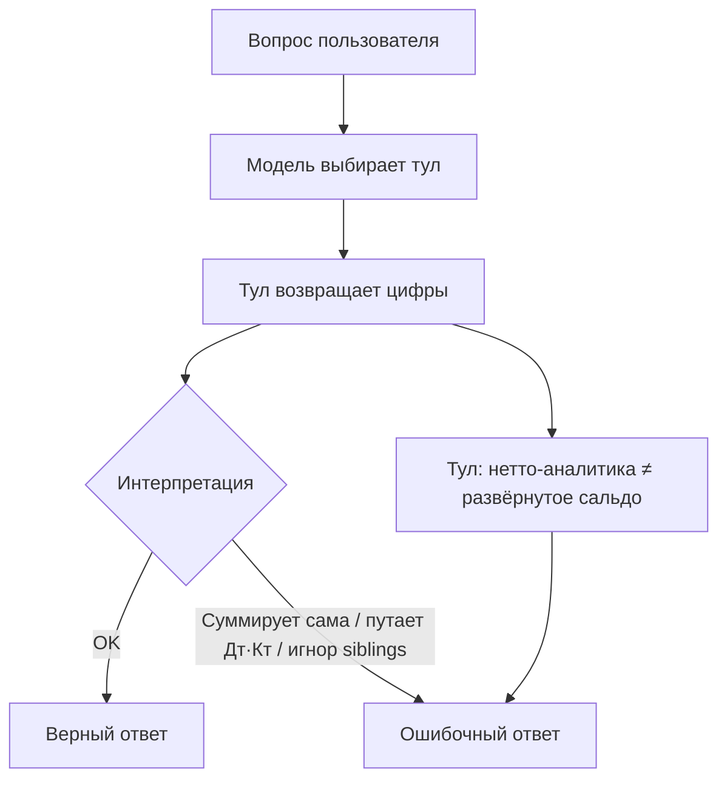
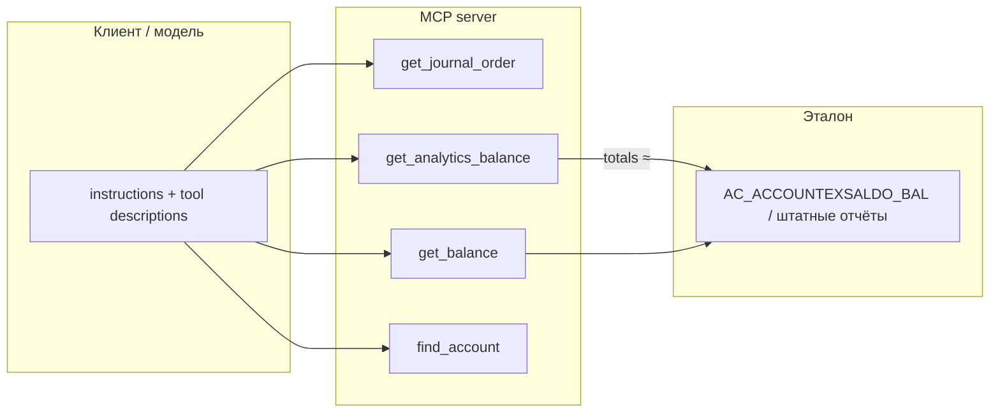

# Постановка: точность ответов пилота (высокий ROI)

**Дата:** 2026-11-11  
**Статус:** в работе (узкий scope)  
**Решение заказчика (2026-11-11):** подтверждена постановка; **только баги с понятными исправлениями, без костылей под частные кейсы.**  
**Контекст:** повторный прогон 19 контрольных вопросов после закрытия BUG-01…15; тулы без `isError`, но часть ответов модели методологически или арифметически неверна.  
**Опора на ТЗ:** [tz-original.md](tz-original.md) — принципы 1, 4, 8; общие параметры (развёрнутое сальдо, субсчета, аналитика); инструкции «не суммируй сам»; слой показателей (`list_metrics`) — этап 5.  
**Опора на пилот:** [pilot-bugs.md](pilot-bugs.md), телеметрия `pilot-eval-results.json` (прогон 2026-11-11).

### Узкий scope (что делаем / что нет)

| Делаем | Не делаем (костыль / этап 5) |
|---|---|
| R1: инструкции + describe JO `groupBy MONTH`, запрет ручной суммы дней | `periodTotals` как обходной путь, если модель «не слушается» |
| R3–R4: ДЗ/КЗ = стороны `get_balance`; обязательный siblings | Специальные эвристики «БелГИСС» |
| R2 (частично): равный оборот узла 90 ≠ выручка; роли только по `accountName` | Тул `suggest_revenue_accounts`, подмена `list_metrics` |
| R5: алгоритм `get_analytics_balance` = `AC_ACCOUNTEXSALDO_BAL` (кэш + окно даты); `fieldName` из `AC_ACCANALYTICSEXT`, не hardcoded `USR$GS_CUSTOMER` | Форсировать totals analytics = `get_balance(ACCOUNTKEY)`; угадывать «поле поставщика» для 60 |
| — | R6 «дата из контекста диалога» без явной даты в вопросе |

---

## 1. Цель

Сделать так, чтобы на тех же 19 вопросах модель **не искажала** уже правильные цифры тулов и чтобы тулы развёртки по контрагентам **совпадали со штатным развёрнутым сальдо** (эталон ТЗ: числа = штатный отчёт).

Не цель этого пакета: полноценный P&L / `list_metrics` (этап 5), aging дебиторки, новые отчёты.

---

## 2. Границы

### В scope

| ID | Тема | Тип работ |
|---|---|---|
| **R1** | Готовые итоги журнала-ордера (не суммировать дни моделью) | инструкции + описание тула (+ опционально `periodTotals` в ответе) |
| **R2** | Выручка / 90: не принимать оборот закрытого `90` за выручку; идти на `90.01`/`90.02` и siblings | инструкции + описания `find_account` / `get_account_analysis` (временный мост до этапа 5) |
| **R3** | ДЗ/КЗ для директора: только развёрнутые стороны нужных счетов; запрет «сложить все дебеты 60+62+76» | инструкции + domain-knowledge |
| **R4** | Обязательный добор `relatedSiblingAccounts` (51/62/90) | инструкции (уже есть — усилить) + проверка в регрессии |
| **R5** | `get_analytics_balance`: развёрнутое сальдо по аналитике (не нетто→split); корректная аналитика на 60 | код тула + описания + тесты |
| **R6** | Дата без явного указания vs контекст «декабрь 2025» в серии вопросов | уточнение инструкций (не ломая правило dataCutoff) |

### Вне scope (осознанно)

- Реализация `list_metrics` / `get_pnl` / aging (этап 5 ТЗ).
- Починка выбора пустого конфига «1» в A6 (низкий ROI, пока нет ОСВ-конфигов в базе).
- Переписывание модели чата / смена LLM.
- Изменение платформы Гедымин (Delphi).

---

## 3. Проблема (по телеметрии)

| Симптом в прогоне | Корневая причина | Покрытие ТЗ |
|---|---|---|
| A4: итог ЖО `2.82M/2.85M` вместо `2.93M/3.25M` | Модель суммировала дневные строки; не `groupBy: MONTH` | Прямо: «не суммируй сам», итоги в туле |
| A3/B4/D2: «выручка» = оборот закрытого 90 | Не пошли в `90.01`/`90.02` из `find_account` | Этап 5 `list_metrics`; до него — мост инструкциями |
| B1: «ДЗ» = сумма дебетов 60+62+76 | Смешение авансов поставщикам с дебиторкой | Развёрнутое сальдо + смысл 60/62 в domain |
| C2/B2: потеряны `51-*` / объём на `62.4-*` | Игнор `relatedSiblingAccounts` | Субсчета LB/RB в ТЗ; siblings — урок пилота |
| A2: 60 Дт/Кт analytics ≠ `get_balance` | Нетто по контрагенту + default «Клиент» на 60 | Эталон = штатное развёрнутое сальдо |
| D3/D4: дата cutoff вместо декабря | Правило «без даты → dataCutoff» | В ТЗ — «дата среза реплики»; нужно уточнить конфликт с явным контекстом периода |

---

## 4. Требования

### R1 — Журнал-ордер: итоги с сервера

**Поведение**

- При вопросе «за месяц / за период целиком» модель вызывает `get_journal_order` с `groupBy: "MONTH"` (или `NONE` для одной строки).
- Итог поступлений/списаний берётся из полей строки (`ncuDebit` / `ncuCredit` группы), **без** ручного суммирования дневных строк в тексте ответа.
- В описании тула явно: «Do not sum ENTRYDATE rows yourself — use MONTH/NONE or read period totals».

**Опционально (если после правок инструкций A4 всё ещё ошибается)**

- В structuredContent добавить `periodTotals: { ncuDebit, ncuCredit }` — агрегация на сервере по всем строкам до группировки ответа.

**Критерий приёмки**

- Повтор A4: итог совпадает с эталоном тула (`≈ 2 932 211.53` / `3 250 514.93` на BG_NEW_FB5, сч.51, декабрь 2025) до копейки.

### R2 — Выручка 90 (временный мост до metrics)

**Поведение**

- Запрещено называть «выручкой» равные `turnoverDebitNcu` ≈ `turnoverCreditNcu` по узлу `90` без разбора субсчетов/соседей.
- После `find_account("90")` при вопросе про выручку обязательно смотреть счета с именами вроде «Выручка…» (`90.01`, `90.02`, siblings) через `get_account_analysis` / `get_balance` по **их** `accountKey`.
- В ответе явно: «пока нет list_metrics — выручка по именованным счетам выручки, не по закрытому обороту 90».

**Критерий приёмки**

- A3/B4/D2: в ответе нет подмены «оборот 90 = выручка»; фигурируют суммы с `90.01`/`90.02` (или явный отказ с просьбой подтвердить определение, если счета выручки не найдены).

**Связь с этапом 5:** после появления `list_metrics` этот мост сужается до отсылки к метрике.

### R3 — ДЗ / КЗ для директора

**Поведение**

- Дебиторка покупателей ≈ развёрнутый **дебет 62** (`totals.debitNcu`).
- Кредиторка поставщикам ≈ развёрнутый **кредит 60** (`totals.creditNcu`).
- Запрещено: «дебиторка = сумма всех дебетовых сальдо 60+62+76».
- Дебет 60 = авансы/переплата поставщикам; кредит 62 = авансы полученные — называть отдельно, не смешивать в «ДЗ/КЗ» без оговорки.
- Источник на дату — только `get_balance` (уже в instructions); analytics — для имён, не для подмены totals директора.

**Критерий приёмки**

- B1: ДЗ ≈ дебет 62; КЗ ≈ кредит 60 на 28.12.2025 (эталон с `get_balance`), без «671 тыс. дебиторки» из суммы дебетов.

### R4 — Siblings

**Поведение**

- Если в ответе тула `relatedSiblingAccounts` непустой — следующий шаг: те же тулы по каждому sibling (или явное ограничение в тексте: «только ветка LB/RB узла X, без 51-1…»).
- Для «деньги на р/с» — 51 + siblings `51-*`; при необходимости отдельно 52*.

**Критерий приёмки**

- C2: в денежных средствах учтены siblings или явно сказано, что взята только ветка `51`.
- Регрессия: в toolTrace при наличии siblings есть повторные вызовы **или** disclaimer в финальном тексте.

### R5 — `get_analytics_balance` ↔ штатное развёрнутое сальдо

**Проблема сейчас**

- SQL: `SUM(debitncu - creditncu)` на аналитику → одно число → `splitSimple` в «только Дт» или «только Кт».
- Totals по всем аналитикам **не обязаны** совпадать с `AC_ACCOUNTEXSALDO_BAL` / `get_balance`.
- Default `USR$GS_CUSTOMER` на счёте 60 даёт пустые/свои юрлица вместо поставщиков.

**Требуемое поведение**

1. **Развёрнутое сальдо по аналитике** в духе платформы:
   - для каждой аналитики: дебетовое и кредитовое сальдо так, чтобы  
     `Σ debitNcu` / `Σ creditNcu` по всем аналитикам (включая пустую) **сходились** с `get_balance` на ту же дату/счёт/`withSubAccounts` (допуск 0.01 NCU),  
     **или** явный режим `mode: "net" | "expanded"` с документацией, где `expanded` — default для 60/62/76.
2. Реализация-кандидат (уточняется на дизайне):
   - развёртка через ту же логику, что `AC_ACCOUNTEXSALDO_BAL` с `fieldName` аналитики **построчно** (если процедура/путь платформы это умеет),  
   - либо корректный расчёт остатка по аналитике от `ac_entry_balance` + обороты (как штатные процедуры), а не «текущий нетто всех проводок до даты» без сверки.
3. **Выбор поля аналитики:**
   - в ответе `find_account` / метаданных счёта — доступные `USR$` аналитики слейблами;
   - для 60: не молчать с «Клиент»; подсказка в описании тула: для поставщиков использовать поле из метаданных счёта (часто отдельный USR$), иначе предупреждение `analyticsFieldNote` в ответе;
   - опционально: `suggestAnalyticsField(accountKey)` или авто-выбор, если на счёте ровно одно контрагентское поле.
4. Totals всегда по **всем** аналитикам; `limit` режет только `rows` (уже заявлено в describe — проверить реализацию expanded).

**Критерий приёмки**

- На BG_NEW_FB5: `get_analytics_balance(60, 2025-12-31)` totals в режиме развёртки = `get_balance(60, …)` debit/credit с допуском 0.01.
- То же для 62.
- A2: модель может показывать топ контрагентов, но **итог долг/аванс** совпадает с `get_balance` или явно помечен как «по аналитике X, сверка с get_balance: …».
- Юнит/интеграционные тесты на сходимость totals.

### R6 — Дата без указания

**Поведение**

- Если в вопросе нет даты **и** нет явного «сейчас / текущий»:
  - для остатков/долгов — `dataCutoff` (как сейчас), дату назвать в первой фразе;
  - если пользователь в том же диалоге/прогоне уже зафиксировал период («декабрь 2025») — **предпочитать этот период**, не прыгать на cutoff без оговорки.
- Для eval/одноходовых вопросов без истории: допустим cutoff, но ответ обязан начинаться с даты среза.

**Критерий приёмки**

- D3 в изоляции: дата среза названа явно.
- Документировать в постановке eval: вопросы с периодом vs без; не сравнивать D3@cutoff с эталоном 31.12 без пометки.

---

## 5. Архитектура решения

**Слои**

1. **Контракт для модели** (`instructions`, `domain-knowledge`, describe тулов) — R1–R4, R6.  
2. **Контракт данных** (`get_analytics_balance`) — R5.  
3. **Регрессия** — скрипт/чеклист эталонных чисел на BG_NEW_FB5 (минимум D1, A4, B1, A2, B5).

Зависимости: R5 может блокировать «идеальный» A2; R1–R4 независимы и делаются первыми.

---

## 6. План задач (порядок работ)

| # | Задача | Результат | Зависит от |
|---|---|---|---|
| 1 | Обновить `instructions.ts` + `domain-knowledge.ts` под R1–R4, R6 | Текст инструкций; без изменения схем где возможно | — |
| 2 | Обновить describe: `get_journal_order`, `get_account_analysis`, `get_analytics_balance`, при необходимости `find_account` | Модель видит «когда / как» | 1 |
| 3 | (Опц.) `periodTotals` в `get_journal_order` | Поле в outputSchema + расчёт | 2 |
| 4 | Спроектировать алгоритм expanded analytics (сверка с `get_balance`) | Короткая ADR в этом файле или отдельно | — |
| 5 | Реализовать R5 + тесты сходимости 60/62 | Код + тест | 4 |
| 6 | Подсказка/выбор analytics field для 60 | Поведение + note в ответе | 5 |
| 7 | Регрессионный прогон: A4, B1, A2, A3/B4 или D2, C2; обновить pilot-bugs / матрицу | Отчёт PASS/FAIL | 1–6 |

Оценка размера: задачи 1–3 ≈ один PR; 4–6 ≈ второй PR; 7 — прогон.

---

## 7. Критерии готовности пакета

- [ ] Повторный прогон минимум A4, B1, A2, C2, A3 (или B4): нет регрессий по уже зелёным D1/B5.
- [ ] A4: итог ЖО = эталон тула.
- [ ] B1: ДЗ/КЗ = стороны `get_balance` 62/60, не сумма дебетов.
- [ ] A2: totals analytics (expanded) ≈ `get_balance` **или** ответ явно опирается на `get_balance` для итогов.
- [ ] Документ постановки отмечен «внедрено» + ссылка на коммит/PR.
- [ ] В [plan.md](plan.md) добавлена строка этапа/волны «ROI accuracy».

---

## 8. Риски

| Риск | Митигация |
|---|---|
| Развёрнутое сальдо по аналитике через сырой SQL не совпадёт с процедурой | Сверять с `AC_ACCOUNTEXSALDO_BAL`; при расхождении — только процедура/официальный путь |
| Усиление инструкций раздует context | Короткие императивные правила; детали — в describe конкретного тула |
| Без `list_metrics` выручка на нестандартных планах останется хрупкой | Честный disclaimer; этап 5 в бэклоге |
| Eval без истории диалога не проверит R6 «контекст периода» | Отдельный ручной кейс или двухходовый eval |

---

## 9. Документ для заказчика (кратко)

### Что даст пакет

После правок чат реже будет **сам складывать** журнал-ордер, **путать выручку с закрытием счёта 90**, **называть дебиторкой авансы поставщикам** и **терять соседние расчётные счета**. Развёртка по контрагентам будет **сходиться с сальдо**, которое бухгалтер видит в Гедымине.

### Для кого

Бухгалтер и руководитель, которые задают те же вопросы, что в пилотном наборе (долги, деньги, журнал-ордер, 90-й счёт).

### Чего пакет не делает

Не вводит готовый отчёт о прибылях и убытках и единый справочник показателей — это следующий этап по исходному ТЗ (`list_metrics`).

### Словарь

- **Развёрнутое сальдо** — отдельно сумма всех дебетовых и всех кредитовых остатков по разрезу (счёт или контрагент), а не одна «нетто» цифра.
- **Sibling-счета** — счета с похожим кодом (`51-1`, `90.01`), которые в дереве плана лежат рядом, а не «внутри» узла `51`/`90`.

---

## 10. Открытые вопросы (к согласованию)

1. **R5:** достаточно ли режима `expanded` как default + сохранение `net` для совместимости, или полностью заменить текущий алгоритм?
2. **Выручка до этапа 5:** достаточно ли инструкций, или нужен тонкий хелпер `suggest_revenue_accounts(chart)` без полного metrics?
3. **R6 в eval:** правим формулировки вопросов D3/D4 (добавить дату) или только поведение сервера?

---

## 11. Решение по умолчанию (если нет ответа заказчика)

При отсутствии ответа в течение согласования:

1. R5 — default `expanded`, параметр `balanceMode: "expanded" | "net"`.
2. Выручка — только инструкции + describe, без нового тула.
3. R6 — усилить instructions; в control-questions для D3/D4 добавить явную дату в следующем цикле eval.
